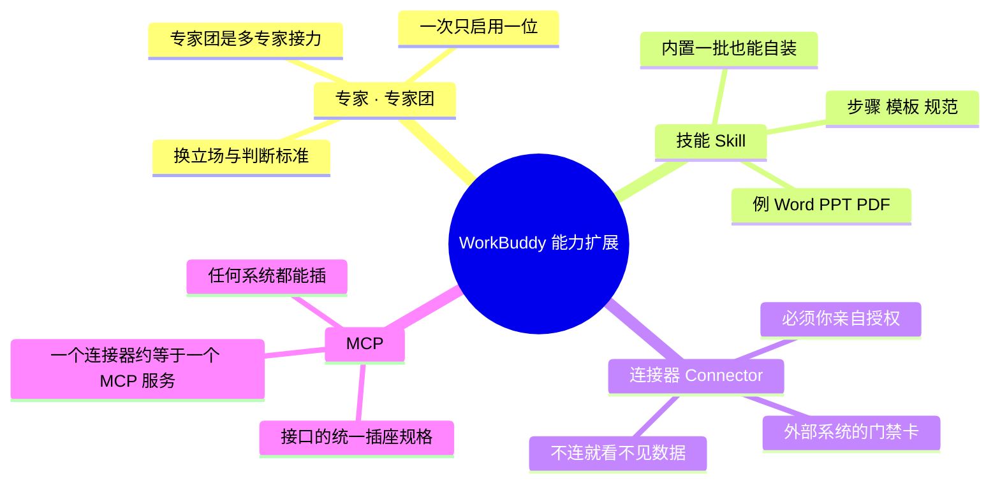

# 数据流分析与业务流程分析：十五个问题怎么答

这两组问题是系统分析的两把尺子：

- **数据流分析（DFD）问"数据怎么流"**——信息系统这个处理器吃了什么、吐了什么。
- **业务流程分析（BFA）问"事情怎么做"**——人在流程里怎么干活。

两者必须交叉校验：流程里的每个活动，在 DFD 里都该对应一个加工；流程里的每张单据，都该是一条数据流或一个数据存储。

> 以下答法统一以「高校档案管理系统」为例，换成你的案例只需替换例子。

---

## 〇、术语速览：WorkBuddy 的四个词

| 名词            | 一句话                                             | 类比                   |
| ------------- | ----------------------------------------------- | -------------------- |
| 专家 / 专家团      | 封装好的一套「专业身份＋方法论＋判断标准」。专家团是几位专家按顺序接力，一个分析、另一个复核。 | 请外部顾问，一次只请一位（或一个顾问组） |
| 技能 Skill      | 一份可执行的作业手册：步骤、模板、排版规范。加载后就照手册干活。                | 员工上岗拿的 SOP 手册        |
| 连接器 Connector | 通往外部系统的钥匙，能读你账户里的邮箱、腾讯文档、企查查。                   | 门禁卡 / 数据管道           |
| MCP           | 一套开放的「插座标准」，规定外部系统用什么方式把工具和数据递过来。               | USB 接口标准，不是某根具体的线    |

**一句话记住**：专家定立场，技能定流程，连接器给数据，MCP 定接口。

---

## 一、数据流分析（看数据：进—变—存—出）

> DFD 逐层分解：顶层图把系统当一个黑盒 → 0 层拆成 4 个加工 → 1 层再把其中一个拆细。  
> 分解不是越细越好，满足「一句话说清、输入输出可列、对应一人或一段程序」就该停手。

### 1. 系统作为信息处理器主要完成什么功能？最重要的输入和输出数据是什么？

**怎么答**

- 按**四段式**定位：采集 → 处理 → 存储 → 输出（提供利用），一句话说清"吃什么、变成什么、给谁用"。
- 输入抓最**原始**的那批：第一张单据、第一次录入的数据。
- 输出抓最**终**的交付物：报表、凭证、检索结果、决策依据。
- 用顶层 DFD 表达：系统画成一个圆，左边进、右边出，主流不超过 3~5 条。

**示例**

> 功能＝接收 → 著录 → 保管 → 检索利用。  
> 最重要输入：各部门移交的**档案实体与移交清单**（含着录信息）。  
> 最重要输出：**档案目录**、查档证明、借阅与利用统计年报。

### 2. 系统作为一个整体，和外界环境存在什么关系？

**怎么答**

先**划边界**（哪些在系统内、哪些是外部实体），再列三类关系：

- **输入流**：环境给系统的（数据、材料、请求）。
- **输出流**：系统给环境的（报表、服务、凭证）。
- **约束**：法规标准、上级要求、预算与技术条件——不出现在数据流里，但决定系统目标。

**示例**

> 外部实体：各科室（移交方）、校领导（要统计）、利用者（查档）、上级档案局（年检）。  
> 约束：《档案法》、DA/T 著录标准、保密与个人信息要求。

### 3. 系统功能复杂，是否能够分解为几个相对独立的又有联系的子系统或子功能？

**怎么答**

能。给三条**分解线**，再给判据：

- 按**业务职能**：采集 / 保管 / 利用 / 鉴定。
- 按**数据主题**：文书档案、人事档案、会计档案。
- 按**管理层次**：操作层、管理层、决策层。
- 判据＝**高内聚低耦合**：每块的数据来源与使用者相对独立，块间接口少而清晰。

**示例**

> 四个子系统：接收著录、保管保护、检索利用、鉴定销毁。  
> 联系：共用"档案主表"和统一档号编码——这就是耦合点，需在接口上定义清楚。

### 4. 分解后的子功能是否仍然很复杂，还可以划分为更细更具体的子功能吗？

**怎么答**

能，但要给出**停止条件**，否则无限细化：

1. 一句话能说清是什么；
2. 输入、输出可以逐条列出；
3. 能对应到一个人或一段程序；
4. 再往下分就是"操作步骤"而不是"功能"了；
5. 每层控制在 7±2 个加工，否则人读不懂。

**示例**

> "检索利用"再分：借阅申请、审批核验、利用登记、统计反馈——到此停止，再细就是点哪个按钮了。

### 5. 每个功能或子功能的输入数据和输出数据是什么？

**怎么答**

用 **IPO 表**（输入—处理—输出）逐条列，并配数据字典：

- 数据流要起**准确的名字**，写"移交清单"而不是"数据"。
- 字典五类条目：数据项 → 数据结构 → 数据流 → 数据存储 → 加工。
- 每条流注明来源与去向，别留孤立箭头。

**示例**

> 借阅审批：输入＝借阅申请（姓名、工号、档号、用途、期限）；处理＝核验权限与密级、判断是否需领导审批；输出＝批准或驳回结果、借阅登记记录。

### 6. 系统中需要长期保存的数据有哪些？如何创建、修改和使用？

**怎么答**

先把数据存储**分四类**：主数据（档案目录、部门人员表）、业务数据（借阅、移交、销毁单据）、报表台账、规则参数（保管期限表、密级表、权限表）。

再对每一类说清**生命周期**：谁在哪个环节创建、谁能修改且是否留痕、怎么查询统计输出、到期如何归档或销毁、如何备份。

**示例**

> 档案目录：长期保存、写入后只读、变更留版本；借阅登记：保存 3~5 年后归档；操作日志：至少留存 6 个月；保管期限表：条款级可配置，改动需审批。

### 7. 在一个业务流程中，数据来源到最后去处是否完整？

**怎么答**

做**数据流闭合性检查**，四条硬规矩：

- 每条流必须有源有宿，不能凭空产生，也不能只进不出。
- 外部实体 → 加工 → 数据存储 → 加工 → 外部实体，全链路能追。
- **父子图平衡**：父图进出的流，必须与子图边界上的流一一对应。
- 对不上的地方，就是需求漏洞或"没人负责的环节"。

**示例**

> 移交清单 → 接收登记 → 档案目录 → 借阅申请 → 利用登记 → 统计报表 → 上报档案局。  
> 若"利用登记"的数据没有回流到统计，统计报表就是死数据——闭环断了。

### 8. 业务流程分析的内容包含哪些？

**怎么答**

业务流程图（TFD）+ 与 DFD 的交叉核对。内容包括：流程清单与目标、活动与步骤、参与者与职责、控制流、手段工具、资源成本、瓶颈。

落点不是"把现有流程搬上网"，而是**先判断哪一步该删、该并、该自动化**。

**示例**

> 活动与加工一一对应：流程图里的"核验权限"＝DFD 里的一个加工；单据"借阅申请单"＝一条数据流。对不上就说明图画漏了。

---

## 二、业务流程分析（看事情：人、步骤、控制、成本）

### 1. 有哪些业务流程？各自目的或想达到的目标是什么？

**怎么答**

先列**流程清单**：一条流程＝有明确起点终点、有可交付结果的一件事。命名用"动词＋对象"。每条补两样：目标（对外交付什么价值）、指标（时长、一次通过率、成本、满意度）。

**示例**

> 移交接收、著录编目、借阅利用、鉴定销毁、统计上报、库房巡检。  
> 例：借阅利用的目标＝48 小时内完成合法查档，且全过程可追溯。

### 2. 流程如何完成？有哪些任务与步骤？活动的开始与结束条件是什么？

**怎么答**

拆到**活动级**（活动名＝动词＋名词，不再往下拆操作），每个活动标三件事：

- **开始条件**：谁提交了什么 / 什么事件触发；
- **前置条件**：材料齐备、权限具备；
- **结束条件**：结果被确认、单据归档。

用泳道图或 BPMN 画出顺序、分支与并行。

**示例**

> 提交申请（始）→ 权限核验 →〔需审批？是：领导审批 / 否：跳过〕→ 实体出库 → 归还核验（终）。

### 3. 这个流程有谁参与？各自完成哪些活动？

**怎么答**

做**角色—活动矩阵**（RACI：负责、审批、被咨询、被告知），区分"岗位"与"具体的人"。特别标出**跨部门交接点**——交接点最容易掉单、最容易拖时间。

**示例**

> 利用者（提出申请）、档案员（核验、出库、登记）、科室负责人（审批）、库房管理员（实体出库）、系统管理员（权限与日志）。

### 4. 流程中有哪些控制流？多个流程之间有什么关系？

**怎么答**

控制流四类：**判断**（条件分支）、**并行分支**（同时做）、**同步会合**（等齐再走）、**循环/返工**（不合格退回），另加异常处理（超期、丢失、越权）。

流程间关系：串行（上游输出＝下游输入）、并行、事件触发、子流程调用。

**示例**

> "鉴定通过"才触发销毁（事件触发）；著录与实体上架可并行；密级变更要回到"重新鉴定"，形成循环。

### 5. 流程用了哪些方式或手段来完成？

**怎么答**

给每个活动标"手段＋载体"：纯手工（纸质单据）、半自动（表单＋人工判断）、系统自动（规则、接口、批处理）；载体写清楚是纸质表、Excel、业务系统还是即时通讯。

同一流程里手段混用，往往就是**可优化的断点**。

**示例**

> 申请走线上表单、审批走系统流转、实体出库仍手工扫码、归还有时靠口头确认——最后一环是典型断点。

### 6. 完成任务所用资源及其成本如何？各环节的增值作用如何？

**怎么答**

资源三类：物理（库房、设备、耗材）、人力（工时×人数）、知识（专业技能与法规）。成本看活动工时、等待时间、返工率。

增值分析分三档：

| 档次    | 含义              | 处理       |
| ----- | --------------- | -------- |
| 真增值   | 用户认可、愿意为之付费     | 保留并放大    |
| 必要非增值 | 法规要求的审批、备份，必须做  | 压缩、并联、限期 |
| 无效    | 等待、重复录入、来回跑腿、返工 | 直接删掉     |

**示例**

> 查档出证＝真增值；保密审批＝必要非增值；同一份信息在三个表里各录一遍＝无效。

### 7. 流程中是否存在瓶颈或阻塞排队现象？

**怎么答**

找**排队点**：待办长期堆积、等待时间占比高、返工率高、只有一个人能做的活动、单点审批。

量化三个数：平均等待时长、在制品数量、一次通过率。对策：并行化、授权下移、批量处理、规则自动化、削掉非增值环节。

**示例**

> 领导每周集中审批一次，借阅平均等待 5 天——瓶颈不在办理，而在等待。改为超期提醒＋额度内自动批准，等待降到半天。

---

## 三、四条判据（考试与实操都用得上）

1. **分解终止**：一句话说清、输入输出可列、对应一人或一段程序、再分就是操作步骤。
2. **父子平衡**：父图的一条流入，必须在子图边界上找得到；找不到＝漏画。
3. **增值三档**：真增值 / 必要非增值 / 无效——优化只动第三档，压缩第二档。
4. **两图互证**：流程活动＝DFD 加工，流程单据＝数据流或数据存储；对不上就回去改图。

---

*系统分析答题框架 · 2026-11-06*
